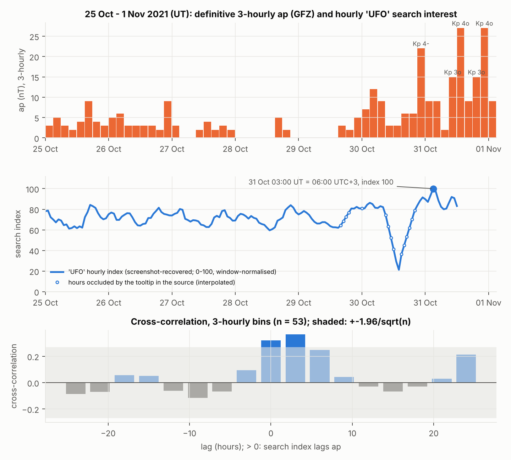

# JABDE Halloween treatise

**Do geomagnetic storms and "UFO" web searches move together? A reproducible statistical reconstruction of a Halloween hypothesis, written in deadpan academic style.**

[](LICENSE)


Full paper: [`treatise.pdf`](treatise.pdf) · Word: [`treatise.docx`](treatise.docx) · Source text: [`treatise.md`](treatise.md)



## What this is

A "treatise" for the (fictional) *Journal of Astrological Big Data Ecology*, Halloween print cycle, by Eduard Samokhvalov.
It takes an old claim (2021, recension 2023: geomagnetic activity, UFO searches and the night of 31 October are linked)
and checks every part that can be checked on real data. The metaphysical framing (sacred geography, "affective harvest",
Tartarean tiers) is the author's own hypothesis, kept as written; the statistics are ordinary and reproducible.

**Data**
- Definitive Kp/ap/Ap geomagnetic indices, 1957-10-01 to 2025-07-20 (GFZ Potsdam via CelesTrak, no licence restriction, attribution requested).
- Worldwide Google Trends interest in "UFO", 2004-2021, and a 7-day hourly line around 31 October 2021. Both are **recovered from the source figures by gridline digitising**, not from the original export (see the limitations in section 4.1 and the note below on how to swap in the real series).

**Methods**: Fourier / Prophet-style annual components, normalised inner-product (dot-product) coherence, instantaneous phase and phase-locking value, Rayleigh test of harmonic phases, vector autoregression and Granger causality, cross-correlation event study, Kuramoto synchronisation calibration.

**Headline numbers (from the paper)**
- The annual geomagnetic and search curves are in antiphase: coherence -0.49 to -0.57 at a 12-15 day lag, mean phase difference 158-162 degrees, carried by the semiannual harmonic.
- 31 October is a quiet date in the 2004-2021 window (17th percentile of Ap); it looks active only when the 2003 storms are included.
- Week of 31 Oct 2021: the search maximum came 4.5 h after the first Kp 4- interval; field-to-search Granger p = 0.060 (one week, 53 bins: weak evidence).
- Limitations are stated in the paper: search components digitised from figures, tiny event sample, and an unidentifiable "mechanism" by construction. Treat the results as exploratory, not as evidence for the mechanism.

## Quick start

```bash
bash build.sh        # re-creates tables, results.json, figures, .tex, .pdf, .docx
python3 code/listing1.py   # (run inside data/) prints the headline numbers
```

## Keywords

geomagnetic indices, Kp, Ap, space weather, Google Trends, UFO, Halloween, spectral analysis, Fourier seasonality,
phase locking, coherence, Granger causality, vector autoregression, Kuramoto model, reproducible research,
data archaeology, digitising figures, satire, pseudoscience, statistics, Python.

## License

[MIT](LICENSE) for the code, text, figures and the author's documents in this repository.
`data/SW-All.txt` is public data from GFZ Potsdam via CelesTrak (https://celestrak.com/SpaceData/); its permission note is in
`data/COPYING.data`. Please cite CelesTrak if you reuse it. See [`CITATION.cff`](CITATION.cff) to cite this work.

## Contents

| Path | What it is |
|---|---|
| `treatise.md` | Master text (pandoc Markdown with LaTeX math). Everything else is generated from it. |
| `treatise.tex`, `treatise.pdf` | LaTeX source (pandoc) and the PDF compiled with xelatex. |
| `treatise.docx` | Word version (pandoc; equations as native Word math). |
| `header.tex`, `build.sh` | LaTeX preamble additions and the one-shot rebuild script. |
| `code/parse_sw.py` | Parses the CSSI space-weather file into daily Kp/ap/Ap (`data/kp_ap_daily.csv`). |
| `code/digitise.py` | Recovers the author's Prophet yearly components (Figures 2–3) and the 7-day hourly Trends line (Figure 8) from the source PNGs by gridline calibration. |
| `code/analysis.py` | All statistics of Section 3 and the Kuramoto calibration of Section 2.4; writes `data/results.json`. |
| `code/figures.py` | Supplementary figures `fig_S1`–`fig_S4`. |
| `code/listing1.py` | Listing 1 of the treatise: condensed, self-contained reproduction of the headline numbers. |
| `data/SW-All.txt`, `data/COPYING.data` | Definitive Kp/ap/Ap 1957-10-01 … 2025-07-20 (GFZ Potsdam via CelesTrak CSSI, no licence restriction, attribution requested). |
| `data/kp_ap_daily.csv` | Parsed daily table (8 × Kp×10, 8 × ap, Ap). |
| `data/digitised_components.csv` | Day-of-year grid (0–364): `fig4_UFO`, `fig4_Ap`, `fig5_UFO`, `fig5_Ap` in % of trend. |
| `data/digitised_trends7d.csv` | Hourly "UFO" index, 24 Oct 15:00 – 31 Oct 15:00 UTC+3, with an `occluded` flag for the 15 hours hidden by the tooltip in the screenshot. |
| `data/results.json` | Every number quoted in the treatise, machine-readable. |
| `fig_*.png` | Figures as referenced by `treatise.md` (source figures `fig_src_*`, supplementary `fig_S*`). |
| `figures/source/` | The three source PNGs read by `digitise.py`, and the overlay checks `overlay_*.png` (red = recovered curve). |
| `source/` | The author's 2021 and 2023 Word documents. |

## Rebuild

`bash build.sh` regenerates the data tables, `results.json`, the figures, and the `.tex`, `.pdf` and `.docx` files.
Requirements: Python 3 with numpy, pandas, scipy, statsmodels, prophet, matplotlib, pillow; pandoc ≥ 3; TeX Live with xelatex and latexmk; fonts Liberation Serif/Sans, DejaVu Sans Mono, DejaVu Math TeX Gyre.

## Replacing the digitised search component with the real series

Export the Google Trends series for `UFO`, Worldwide, 2004-01-01 – 2021-09-30 (`multiTimeline.csv`, as downloaded) into `data/` and re-run `analysis.py`. It will fit the same Prophet model (multiplicative, yearly order 10) to the export and use that component in place of the digitised one; `results.json` records which source was used under `ufo_component_source`.

## Conventions

- Lags: τ > 0 means the search curve lags the geomagnetic curve.
- Day of year is 0-based on a 365-day (non-leap) grid; 31 October = 303; 29 February is folded onto 28 February in climatologies.
- Kp×10 encoding in the CSSI file: 37 = 4−, 40 = 4o, 43 = 4+.
- Observer time in the Trends screenshot is UTC+3 (Moscow, no seasonal shift); all event-window statistics are computed in UT.
