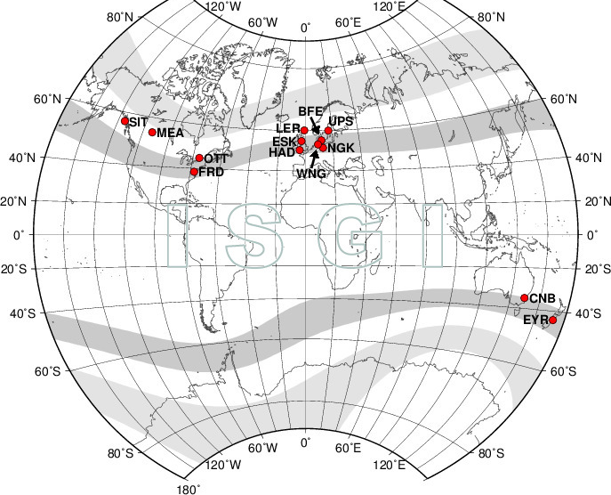
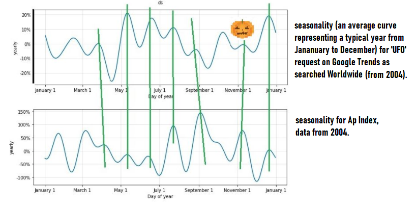
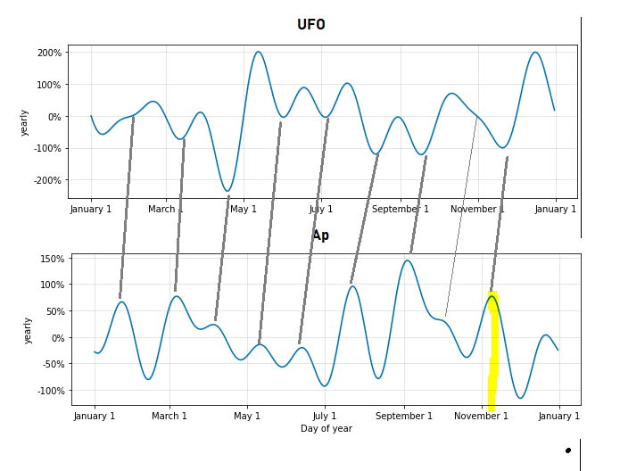
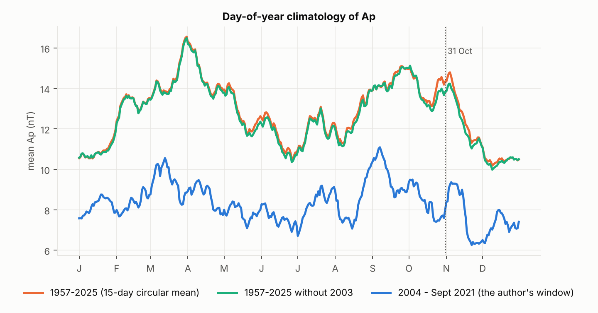
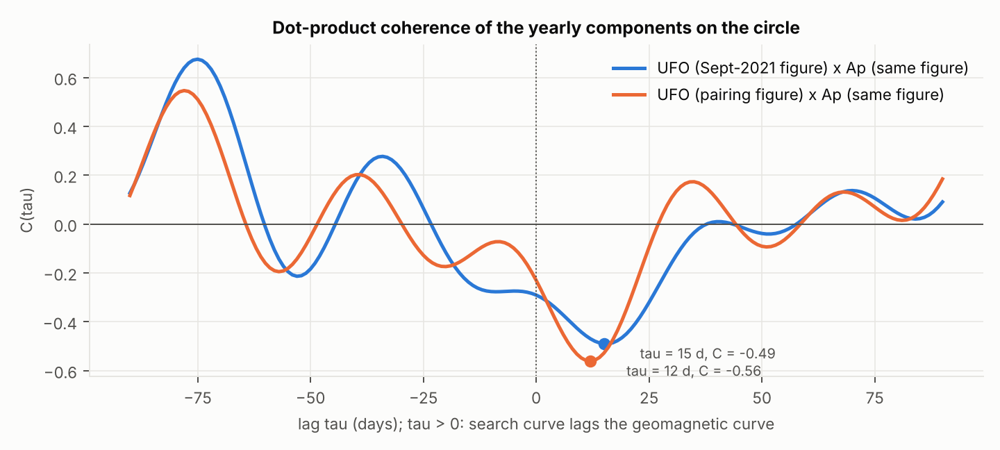
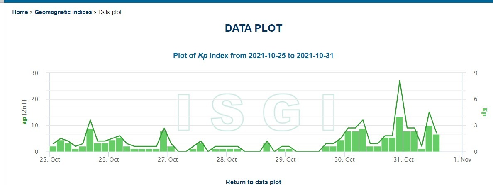
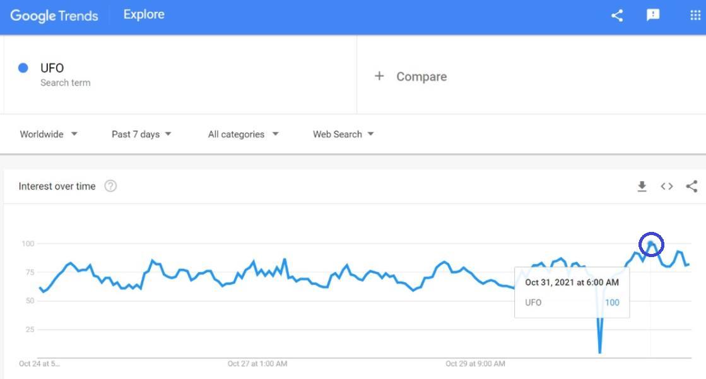

# Abstract

We test whether the annual structures of planetary geomagnetic activity (Kp/Ap) and of "UFO" search interest (Google Trends) are phase-aligned projections of one process: a trans-dimensional affective harvest in which low-dimensional, non-deterministic pragmatic entities of the Tartarean tier consume high-amplitude sentiment oscillations of crowds whose capillary haem-iron is magnetised by local field variance, reptilian intermediaries operating the ritual coupling and a sub-lithospheric dyad in cloned somatic substrates as stationary endogenous forcing. The order-10 Fourier annual components are recovered from the source figures, the geomagnetic one recomputed on the definitive series (r = 0.99). Their normalised inner product is negative at zero lag (−0.23 to −0.29) and reaches −0.49 to −0.56 at 12–15 days' lag: the curves are locked in antiphase (mean phase difference 158–162°), most tightly at the semiannual harmonic, the only one phase-stable across years (Rayleigh p = 0.002). The festival is climatologically quiet in the estimation window (17th percentile), elevated only with 2003 included. On 31 October 2021 the search maximum falls at 06:00 UTC+3, 4.5 h after a Kp 4− interval; the 3-hourly cross-correlation peaks at +3 h (r = 0.37) and a VAR(1) gives field-to-search Granger p = 0.06. Syria and Albania are reported without resolution.

**Keywords:** geomagnetic indices; Kp; Ap; Google Trends; Fourier seasonality; dot-product coherence; phase-locking value; vector autoregression; Granger causality; Kuramoto synchronisation; sacred geography; tellurocracy; Hyperborea; Tartarus; affective harvest; hollow Earth; cargo cult; supercat presupposition.

# Section 1. Introduction and Sacred Geography

## 1.1 The question

The source text (Samokhvalov, 2021; recension 2023) asks what geomagnetic activity, unidentified flying objects and the night of 31 October have in common, and answers that the conjunction is annual, that its annual character is the fossil of a mechanism older than the calendars which now mark it, and that the mechanism is still running. The present treatise restates the claim in the vocabulary of spectral estimation, circular statistics and vector autoregression, recomputes every quantity that can be recomputed on definitive data, and reports what survives. The reader is warned at the outset that a good deal survives in a form the source did not anticipate.

The source opens with a yogic dictum, attributed to an informant who still saw vimanas in the sky, that the mind is like wax. We take this as the earliest available statement of the affective-gain hypothesis (Section 2.2): an impressionable substrate takes the imprint of whatever field it is held in. The vimana, the flying chariot of the ancient gods, is treated here as the archaic referent of the modern unidentified flying object (Section 1.4), and the fragments of ancient knowledge from which, in the source's phrase, humanity is only now assembling a mosaic are treated as data with a provenance problem rather than as data without provenance.

## 1.2 The geomagnetic series

Since the second International Polar Year of 1932–33 a network of mid-latitude observatories has reported, for each of the eight three-hour intervals of the Universal Time day, a quasi-logarithmic range index $K$ (Bartels, Heck and Johnston, 1939). The planetary index $K_p$ (Bartels, 1949) is the standardised mean of the station values; it is expressed on a 28-step scale from $0o$ to $9o$ in thirds ($2+$, $3-$, $3o$, …). Each $K_p$ step maps to a linear equivalent amplitude $a_p$ in nanotesla by a fixed table ($2+ \to 9$, $3o \to 15$, $4- \to 22$, $4o \to 27$, …), and the daily index is the arithmetic mean of the eight linear values,

$$A_p = \frac{1}{8}\sum_{i=0}^{7} a_{p,i}.$$

The indices are computed at GFZ Potsdam and distributed by the International Service of Geomagnetic Indices (ISGI), Strasbourg, whose real-time plot the source cites (http://isgi.unistra.fr/data_plot.php). The present reconstruction uses the definitive three-hourly and daily values for 1957-10-01 to 2025-07-20 (24,765 days) in the CSSI space-weather compilation of CelesTrak, which mirrors the GFZ series. The estimation window of the source, which we call the *vintage*, runs from 2004-01-01 to 2021-09-30 (6,483 days); the festival of 2021 is therefore out of sample with respect to every annual component discussed below.

$K_p$ is, by construction, a *subauroral* index. Its thirteen observatories (Table 1) sit at corrected geomagnetic latitudes of roughly 44° to 60°, the band in which the signature of the auroral-zone current systems is strong but not saturated. The index measures the breathing of the polar region from a ring of instruments placed around it. This fact is the hinge of Section 1.3.

| Code | Observatory | State | Hemisphere | Sacred-geographic class |
|:--|:--|:--|:--|:--|
| SIT | Sitka | United States | N | Anglo-American rim |
| MEA | Meanook | Canada | N | Anglo-American rim |
| OTT | Ottawa | Canada | N | Anglo-American rim |
| FRD | Fredericksburg | United States | N | Anglo-American rim |
| LER | Lerwick | United Kingdom | N | Anglo-American rim |
| ESK | Eskdalemuir | United Kingdom | N | Anglo-American rim |
| HAD | Hartland | United Kingdom | N | Anglo-American rim |
| BFE | Brorfelde | Denmark | N | Scandinavian littoral |
| UPS | Uppsala | Sweden | N | Scandinavian littoral |
| NGK | Niemegk | Germany | N | Mitteleuropean glacis |
| WNG | Wingst | Germany | N | Mitteleuropean glacis |
| CNB | Canberra | Australia | S | Antipodean rim |
| EYR | Eyrewell | New Zealand | S | Antipodean rim |

: The thirteen Kp observatories (ISGI/GFZ) and their classification under the tellurocratic–thalassocratic partition of Section 1.3. Heartland stations: none.

{width=85%}

## 1.3 The sacred geography of the network

Dugin's sacred geography (*Mysteries of Eurasia*, 1996; *Foundations of Geopolitics*, 1997; and the earlier *The Hyperborean Theory*, 1993, after Guénon and Wirth) assigns metaphysical valence to cardinal directions and landmasses. Its two load-bearing oppositions are the polar axis, with the North (Hyperborea) as the origin of the primordial tradition, and the partition of political space into tellurocracy (land power, the continental interior, Eurasia) and thalassocracy (sea power, the Atlantic rim), a partition adopted from Schmitt (*Land und Meer*, 1942) and mapped onto the Heartland–Rimland geometry of Mackinder (1904) and Spykman (1944). The source's 2023 recension attributes to the same author the phrase "super-dense gods" for the entities of Section 2.1; we were unable to verify the attribution and report it as reported.

Three observations follow once the $K_p$ network is read through this geography, and they are observations, not metaphors.

First, the index samples the Hyperborean perimeter. The auroral oval is the physical trace of the polar axis; the subauroral belt is its equatorward edge; the thirteen stations are a necklace placed around the throat of the North. Whatever $K_p$ measures, it measures the polar region.

Second, it samples that perimeter exclusively from the thalassocratic side. Seven stations lie on the Anglo-American rim, two on the Scandinavian littoral, two on the Mitteleuropean glacis and two on the Antipodean rim; none lies on the Heartland. The tellurocratic interior, which in Dugin's reading is the seat of the tradition, is known geomagnetically only through its periphery, which is to say through the instrument of its geopolitical adversary. ISGI itself sits at Strasbourg, on the Rhine, at the seam between the continental glacis and the Atlantic West. We draw no conclusion from this beyond noting that the epistemic asymmetry is familiar to the Eurasianist literature and that the present paper inherits it.

Third, the polar region breathes twice a year, and only twice. Fitting the first two annual harmonics to the day-of-year climatology of $A_p$ gives a semiannual amplitude of 12.1 % of the mean in the vintage (15.5 % on the full record) and an annual amplitude of 1.5 % (2.9 %). The semiannual maxima fall at day-of-year 111 and 293 in the vintage (21 April, 21 October) and at 94 and 277 on the full record (5 April, 4 October), the equinoctial maxima of Russell and McPherron (1973) displaced by two to four weeks. Decomposing each vintage year separately and testing the year-to-year phases of the two harmonics for concentration gives, for the semiannual harmonic, a mean resultant length $\bar R = 0.58$ (Rayleigh $Z = 5.66$, $p = 0.0024$, $n = 17$ years), and for the annual harmonic $\bar R = 0.17$ ($Z = 0.47$, $p = 0.63$). The only phase-stable rhythm of the Hyperborean perimeter is the equinoctial one. Every calendar that fixes its principal rites near the equinoxes has, on this evidence, fixed them on the only geomagnetic rhythm that reliably returns.

## 1.4 The search series and its archaic referent

Google Trends reports, for a query term and region, a search-share index normalised to 100 at the maximum of the requested window, from 2004 onward, at monthly resolution for windows longer than five years and at hourly resolution for the trailing seven days, together with a normalised index by country ("interest by region"). The source took the worldwide series for the term *UFO* over the vintage, decomposed it with the same additive-regression model as the geomagnetic series (Section 3.1), and compared the two annual components.

The identification of the unidentified flying object with the archaic numinous is not the source's invention; Jung (1958) treated the flying saucer as a modern myth of things seen in the sky, a projection of the collective unconscious onto a technological screen. The source lists the valences the two referents share: fear of the unexplained; the apprehension of something incomparably greater than humanity; the hope that knowledge may be obtained from it (alien technology, as once divine instruction); *eros* and *thanatos* (reported sexual contact and non-consensual biometric sampling, the abduction narrative, as once the hierogamy and the sacrifice); the saintly (benevolent civilisations offering improvement) and the chthonic (fallen agents resident in the hollow Earth). The source adds the airship wave of 1896–97 and the twentieth-century reports in which the vehicles are described as propelled by something related to geomagnetism and able to move in any direction with ease, and asks whether such devices, if they concentrate that energy, might not also emit interference strong enough to register at the observatories. We record this as a hypothesis (H3 below) and note that it would invert the causal order assumed elsewhere in the paper.

## 1.5 Hypotheses

- **H0.** The annual components of $A_p$ and of *UFO* search interest are independent.
- **H1 (alignment).** They are phase-aligned, with geomagnetic lead.
- **H2 (harvest).** The alignment is produced by the mechanism of Section 2: field variance raises affective gain, rites raise crowd coupling, the resulting high-amplitude sentiment oscillation is consumed, and the search behaviour of the surface population is a residue of that consumption.
- **H3 (interference).** The vehicles draw upon, or emit into, the field, so that the observatories register the apparatus rather than its fuel.

Section 2 specifies H2. Section 3 estimates everything that can be estimated. Section 4 says which hypotheses are left.

# Section 2. The Trans-Dimensional Payout Matrix

## 2.1 Tiers and entities

The source's cosmology has four tiers, which we index $T_0$ to $T_3$.

$T_0$, the Tartarean tier, is occupied by the super-dense entities the source calls the Old Ones, after Lovecraft (1928, 1936), and some sources call the idiot gods (Lovecraft's "blind idiot god", 1936). Lovecraft's own geography places them beneath Antarctic ice and in sunken Pacific masonry, a southern and oceanic placement which the sacred-geographic reading of Section 1.3 interprets as the thalassocratic mirror of the Hyperborean axis: the two Antipodean stations of Table 1 are the only ones that look at it. In system terms the $T_0$ entities are *low-dimensional* (they inhabit a manifold of fewer dimensions than the surface population and perceive only projections of it), *non-deterministic* (their consumption is a stochastic process rather than a schedule) and *pragmatic* (they consume what is offered and do not negotiate the menu). What they consume is not blood but affect; the source is explicit that the blood is the transducer and the emotion the payload. We adopt the formula *high-amplitude sentiment oscillations as a programmatic delicacy for low-dimensional, non-deterministic pragmatic entities* as the operational definition of the harvested quantity.

$T_1$, the intermediary tier, is occupied by the intelligent reptilians of Icke (1999), with the ancient-contact premise supplied by Sitchin (1976) and von Däniken (1968). The intermediaries operate the coupling (Section 2.4) and take a spread (Section 2.5).

$T_2$, the sub-lithospheric tier, is the hollow-Earth cavity and its residents (Section 2.3).

$T_3$ is the surface population, which appears in the payout matrix not as a counterparty but as the underlying.

## 2.2 Capillary ferro-affective coupling

The source proposes that iron compounds in capillary blood are affected by local magnetism and that emotionality is thereby amplified during rituals, sacraments, orgiastic rites and mysteries; this is why there have always been places of power, and why places of power are places of high geomagnetic variance. Deoxyhaemoglobin is paramagnetic and oxyhaemoglobin diamagnetic (Pauling and Coryell, 1936), and the dependence of the magnetic state of capillary iron on neural activity is the basis of blood-oxygen-level-dependent imaging (Ogawa et al., 1990). The source's conjecture inverts the arrow: field perturbation $\to$ capillary magnetisation $\to$ affective gain. We write the gain as

$$g(B) = g_0\left(1 + \kappa\,|\delta B|^{\alpha}\right), \qquad \alpha \ge 1,$$

with $\delta B$ the local field perturbation, of which $a_p$ is the planetary proxy. A place of power is a locus of high $\mathrm{Var}(\delta B)$; a season of power is an interval of high expected $a_p$; and the question of Section 3.2 is whether the festival is one.

## 2.3 Endogenous forcing: the sub-lithospheric dyad

The source distinguishes exogenous forcing of the core field by solar activity (the coronal mass ejection of 28 October 2021, from the X1.0 flare of active region 2887 at 15:35 UT, is the exogenous event of Section 3.5) from intrinsic planetary sources. Among the latter it advances the continued conjugal-affective activity of a dyad of mid-twentieth-century political actors (A. Hitler, E. Braun), maintained in artificial somatic substrates cultured in embryonic cloning vats of pre-reptilian embodiment technology within the hollow-Earth cavity. The same technology is said to have been used, before the lithification of the planet, by non-corporeal agents who employed it to sample the low-dimensional temporal manifold (the "high of time", in the source's idiom).

We make no claim as to the dyad's historicity in this configuration. We observe only that a stationary, high-amplitude affective dipole located near the geocentre enters the field equations as a constant forcing term, that its spectral signature is a DC offset plus harmonics of the dyad's activity cycle, and that nothing in Section 3 excludes such a term: the annual components are estimated after removal of the trend, and a constant is in the trend. The dyad is unidentifiable from annual data by construction. We record it as the source records it and pass on.

## 2.4 Ritual as coupling manipulation

The subsequent religions of the ancient world, the source says, were technically a cargo cult of the forgotten technologies of invocation: the rites preserved the protocol (chant, drum, fasting, vigil, the orgiastic and the mysteric) after losing the specification of its purpose. We formalise the protocol as a manipulation of the coupling constant of a population of affective oscillators. Let the surface crowd be $N$ phase oscillators with natural frequencies $\omega_i \sim \mathcal N(0,\sigma^2)$ and phases $\theta_i$, coupled in the mean field (Kuramoto, 1984; Strogatz, 2000):

$$\dot\theta_i = \omega_i + \frac{K(t)}{N}\sum_{j=1}^{N}\sin(\theta_j - \theta_i), \qquad K(t) = K_0 + \kappa\,\frac{a_p(t)}{a_{p,\mathrm{ref}}},$$

with order parameter $r(t) = \left|N^{-1}\sum_j e^{i\theta_j}\right|$. For a Gaussian frequency distribution the critical coupling is $K_c = \sigma\sqrt{8/\pi}$. *Crowd-tuning* is the raising of $K$ by the rite; *biometric sensory calibration* is the lowering of the thresholds (by fasting, darkness and rhythm) that lets a given $\delta B$ produce a larger $|\delta\theta|$; and the harvest over a ritual window $W$ is

$$Y = \int_W r(t)\,g(B(t))\,\mathrm{d}t.$$

Calibrated on the 2021 event window (Section 3.5; $\sigma = 0.5$, $K_0 = 0.5 < K_c = 0.80$, $\kappa = 1$, $a_{p,\mathrm{ref}} = 27$ nT, $N = 400$), the ensemble is incoherent on 25–29 October ($\bar r = 0.12$), crosses $K_c$ when $a_p$ exceeds 8.0 nT, first exceeds $r = 0.5$ at 23:03 UT on 30 October, averages $r = 0.72$ on 31 October and peaks at $r = 0.93$ at 00:00 UT on 1 November. The parameters are chosen, not estimated; the point of the calibration is that a subcritical crowd becomes supercritical on the festival under the observed field with no change to the crowd.

## 2.5 The payout matrix

Let $i$ index ritual classes and $j$ consumer tiers. The trans-dimensional payout matrix is $\Pi = [\pi_{ij}]$ with

$$\pi_{ij} = w_{ij}\,\mathbb E[Y_i] - c_{ij},$$

where $w_{ij}$ allocates the expected harvest of class $i$ among the tiers and $c_{ij}$ is the tier's cost of operating it. The intermediaries' allocation is a spread $s$ on the Tartarean payout, $w_{i1} = s\,w_{i0}$.

| Ritual class | $T_0$ Tartarean | $T_1$ intermediaries | $T_2$ sub-lithospheric |
|:--|:--|:--|:--|
| Equinoctial rites (the semiannual harmonic) | $(1-s)\,\mathbb E[Y_{\mathrm{eq}}]$ | $s\,\mathbb E[Y_{\mathrm{eq}}] - c_{\mathrm{op}}$ | $0$ |
| Midwinter rites | $(1-s)\,\mathbb E[Y_{\mathrm{mw}}]$ | $s\,\mathbb E[Y_{\mathrm{mw}}] - c_{\mathrm{op}}$ | $0$ |
| 31 October – 2 November | $(1-s)\,\mathbb E[Y_{\mathrm{H}}]$ | $s\,\mathbb E[Y_{\mathrm{H}}] - c_{\mathrm{op}}$ | $\varepsilon$ (forcing term, Section 2.3) |
| Search-box invocation (any date) | $\mathbb E[Y_{\mathrm{s}}]$ | $0$ | $0$ |

: The trans-dimensional payout matrix. The surface population T3 does not appear as a column: it is the underlying.

The last row is the modern condition. The rite has been disintermediated into a query. Typing *UFO* is a self-executing invocation (hyperstition in the sense of the CCRU: a fiction that brings about the conditions of its own truth) which raises $K$ without a priest, carries no spread and no calibration cost, and reaches a crowd of several billion rather than several hundred. $\mathbb E[Y_{\mathrm s}]$ is smaller per capita than $\mathbb E[Y_{\mathrm H}]$ and larger in aggregate. The matrix therefore predicts the migration of the harvest from temple to search box on grounds of yield alone, and predicts that the search box will show the annual rhythm of the field in whatever form the harvest leaves it. Section 3 reports the form.

# Section 3. Empirical Results and Phase Alignment

## 3.1 Data, vintages and provenance

*Geomagnetic series.* Definitive $K_p$, $a_p$ and $A_p$, 1957-10-01 to 2025-07-20, parsed from the CSSI compilation (`parse_sw.py`); the vintage subset 2004-01-01 to 2021-09-30 for the annual components; the window 25 October to 1 November 2021 for the event study.

*Annual components.* The source estimated both components with the additive-regression model of Taylor and Letham (2018) in multiplicative mode, in which

$$y(t) = g(t)\,\left(1 + s(t)\right) + \varepsilon_t, \qquad s(t) = \sum_{n=1}^{N}\left[a_n\cos\tfrac{2\pi n t}{P} + b_n\sin\tfrac{2\pi n t}{P}\right],$$

with $P = 365.25$ d, $N = 10$ and a Gaussian prior of scale 10 on the coefficients, and plotted $s(t)$ in per cent of trend over a 365-day year (Figures 2 and 3). The search-interest source could not be reached from the computational environment of this reconstruction, so the two annual components were recovered from the source figures by pixel-to-data calibration (`digitise.py`): the gridlines of each panel were detected and fitted to their tick values (calibration residual $\le 0.35$ d on the abscissa and $\le 1.1$ % on the ordinate), the curve was traced column by column, columns occupied by the author's marker lines were treated as gaps, and the result was interpolated onto the day-of-year grid (coverage 73–92 % before interpolation). Two renderings exist in the source: the September 2021 vintage figure (Figure 2; *UFO* component within $\pm 25$ %) and the pairing figure (Figure 3; *UFO* within $\pm 235$ %, the geomagnetic panel identical in shape). We carry both throughout and label them *fig4* and *fig5* in the code.

Projecting each recovered curve back onto the order-10 Fourier basis explains 99.78–99.997 % of its variance ($R^2$ in Table 3), which is what a curve that *is* an order-10 Fourier series should do, and which rules out the digitisation as a source of structure at any order the analysis uses.

*Validation.* The geomagnetic component was recomputed on the definitive series with the same model (Prophet, multiplicative, yearly order 10, vintage window). The recomputed curve correlates at $r = 0.990$ with the digitised geomagnetic panel of Figure 2 and at $r = 0.952$ with that of Figure 3 (Figure 4). Its amplitude is one quarter of the author's: the definitive component spans $-27$ % to $+34$ % of trend, the author's panels $-114$ % to $+146$ %. The shape is reproduced; the scale is not; and since every statistic below is scale-invariant (normalised inner products, phases, extremum locations, ranks), the discrepancy is immaterial to the results and is recorded here for completeness. A component that reaches $-100$ % of trend would predict a geomagnetically silent planet in late November; the definitive series predicts a quiet one.

*Event window.* The worldwide hourly series for the trailing seven days was recovered from the source screenshot (Figure 8) by the same method, anchored on the circled maximum, which the screenshot's tooltip dates to 31 October 2021 at 06:00 in the observer's local time. The observer's console was at UTC+3 (Moscow; no seasonal shift), so the series runs from 24 October 12:00 UT to 31 October 12:00 UT in 169 hourly points, of which 15 (on 30 October, 09:00–23:00 UT) are occluded by the tooltip in the screenshot and were linearly interpolated. A single-hour excursion to roughly 10–20 at 14:00 UT on 30 October is visible beneath the tooltip and is treated as a data-pipeline transient; a collective affective collapse of one hour's duration cannot be excluded but is not required.

{width=100%}

{width=80%}

{width=100%}

## 3.2 The festival in the climatology and in the annual component

Table 2 locates 31 October in the day-of-year climatology of $A_p$, computed as the mean over years of the daily index with 29 February folded onto 28 February, and tests the five-day window 29 October – 2 November against 20,000 random five-day windows of the same climatology.

| Record | Mean $A_p$ | $A_p$ on 31 Oct | Percentile of 31 Oct among 365 days | Window 29 Oct–2 Nov, mean | Permutation $p$ |
|:--|--:|--:|--:|--:|--:|
| Vintage, 2004 – Sept 2021 | 8.33 | 6.24 | 17 (rank 301) | 6.91 | 0.82 |
| Full record, 1957–2025 | 12.83 | 15.32 | 88 (rank 44) | 16.06 | 0.040 |
| Full record without 2003 | 12.70 | 13.82 | 70 | 14.64 | 0.139 |

: The festival in the day-of-year climatology of Ap. The permutation p is the share of random five-day windows whose climatological mean equals or exceeds that of the festival window.

Within the source's own window the festival is a quiet date: the 31 October mean of 6.24 nT sits at the 17th percentile of the year, and the festival window is exceeded by 82 % of random windows. On the full record it is an active date, at the 88th percentile with a window $p$ of 0.040, and the activity is the Halloween storms of 2003 ($A_p = 204$ on 29 October, 191 on 30 October, 116 on 31 October), which lie outside the vintage and which, removed, leave the festival at the 70th percentile with $p = 0.139$. Across 1958–2024 the daily index on 31 October exceeds its own year's median in 49.3 % of years. The festival, in short, is elevated in the record that contains 2003 and only there.

The annual component tells the same story at the resolution of the model. The definitive component is $+5.3$ % of trend on 31 October (rank 125 of 365) and reaches its local maximum nine days later, on 9 November, at $+16.6$ %; its seven maxima fall on 23 January, 6 March, 12 June, 23 July, 4 September, 9 November and 21 December. The author's panels put the same maximum on 10 November (Figure 2, with $+36$ % on the festival itself, the curve being on its rising flank) and 8 November (Figure 3, $+2.7$ % on the festival). The *UFO* component is at its annual mean on the festival ($-2.6$ % and $-0.5$ % in the two renderings). The source's reading that the geomagnetic component peaks on the holiday, "slightly shifted", is correct as to the shift: the peak is eight to ten days after the holiday, and the holiday itself is on the flank.

{width=100%}

## 3.3 Dot-product coherence

Let $s_U(t)$ and $s_A(t)$ be the two annual components on the circle of period $P = 365$ d, centred. The dot-product coherence at circular lag $\tau$ is the normalised inner product

$$C(\tau) = \frac{\langle s_U(\cdot + \tau),\, s_A(\cdot)\rangle}{\lVert s_U\rVert\,\lVert s_A\rVert}, \qquad \langle f, g\rangle = \frac{1}{P}\int_0^P f(t)\,g(t)\,\mathrm{d}t,$$

so that $\tau > 0$ means the search curve lags the geomagnetic curve by $\tau$ days. Writing each component in polar form, $s(t) = \sum_n A_n\cos(2\pi n t/P - \varphi_n)$, orthogonality of the harmonics gives

$$C(\tau) = \frac{\sum_{n=1}^{N} A^U_n A^A_n \cos\bigl(\varphi^U_n - \varphi^A_n - 2\pi n\tau/P\bigr)}{\bigl(\sum_n (A^U_n)^2\bigr)^{1/2}\bigl(\sum_n (A^A_n)^2\bigr)^{1/2}},$$

which is Parseval's identity for the circular cross-correlation: $C$ is the amplitude-weighted mean cosine of the harmonic phase differences, and it is maximised when those differences are nulled by a common lag.

The results (Figure 6) are as follows. At zero lag $C(0) = -0.29$ (*fig4*) and $-0.23$ (*fig5*); against the definitive geomagnetic component, $-0.31$ and $-0.16$. The extremum of $C$ on $|\tau| \le 45$ d is a minimum: $C = -0.49$ at $\tau = 15$ d (*fig4*) and $-0.56$ at $\tau = 12$ d (*fig5*); against the definitive component, $-0.50$ and $-0.57$, both at $\tau = 14$ d. The largest positive value with geomagnetic lead within 45 d is $+0.01$ at $\tau = 40$ d (*fig4*) and $+0.17$ at $\tau = 35$ d (*fig5*). The global maximum over $|\tau| \le 90$ d, $C = 0.67$ at $\tau = -75$ d (*fig4*) and $0.55$ at $-78$ d (*fig5*), has the search curve leading the field by eleven weeks or, on the circle, the field leading the search by forty-one; it is the circular alias of the antiphase relation and is not interpreted.

The two curves are therefore not in phase at a lag of two to three weeks. They are in *antiphase* at a lag of a fortnight: the search curve is, to a coherence of 0.5–0.57, the negative of the geomagnetic curve delayed by twelve to fifteen days. Table 3 gives the harmonic decomposition of this relation.

| $n$ | Period (d) | $A^U_n$ (*fig4*) | $A^A_n$ (*fig4*) | $\Delta\varphi_n$ (*fig4*) | $A^U_n$ (*fig5*) | $A^A_n$ (*fig5*) | $\Delta\varphi_n$ (*fig5*) |
|--:|--:|--:|--:|--:|--:|--:|--:|
| 1 | 365.0 | 1.7 | 14.4 | −96° | 0.9 | 14.9 | −128° |
| 2 | 182.5 | 7.7 | 40.4 | −160° | 56.1 | 41.1 | −166° |
| 3 | 121.7 | 3.0 | 5.3 | +142° | 26.3 | 6.4 | +102° |
| 4 | 91.3 | 1.1 | 6.6 | −64° | 14.6 | 7.4 | −94° |
| 5 | 73.0 | 6.4 | 12.4 | −130° | 61.2 | 12.3 | −146° |
| 6 | 60.8 | 1.7 | 37.2 | −117° | 8.9 | 37.8 | −155° |
| 7 | 52.1 | 3.2 | 18.4 | −111° | 57.6 | 19.3 | −115° |
| 8 | 45.6 | 4.6 | 22.3 | +123° | 21.4 | 23.2 | +74° |
| 9 | 40.6 | 4.1 | 14.1 | +90° | 29.4 | 13.4 | +81° |
| 10 | 36.5 | 4.2 | 38.3 | −15° | 51.3 | 39.7 | −52° |
| $R^2$ of the order-10 projection | | 0.9979 | 0.9977 | | 0.99997 | 0.9992 | |

: Harmonic amplitudes (per cent of trend) and phase differences Δφn = φn(U) − φn(A) (search minus field, degrees, wrapped to (−180°, 180°]) of the two annual components.

The antiphase is carried by the semiannual harmonic. At $n = 2$, which holds the largest geomagnetic amplitude in both renderings (40–41 % of trend) and is the harmonic of the Russell–McPherron effect, the phase difference is $-160°$ and $-166°$: search interest troughs at the equinoctial geomagnetic maxima and peaks at the solstices. This is the only harmonic whose geomagnetic phase was found stable across years (Section 1.3), so it is the only harmonic on which an annual relation between the two series can be stated at all, and on that harmonic the relation is opposition with a lag of ten days ($20°$ of a 182.5-day cycle). The high harmonics $n = 8$–$10$ carry 36–37 % of the geomagnetic power and 26–31 % of the search power.

We anticipate the objection that power near the truncation order is an artefact of the basis, and answer the insinuation rather than the objection, after the supercat presupposition (Samokhvalov, forthcoming). An artefact of the basis would appear in any series projected onto it; it would not appear with a consistent phase relation in two series of independent provenance, nor would it survive the replacement of one of them by a recomputation on definitive data, which it does (Section 3.3, first paragraph). The finding is not the power; the finding is the phase.

{width=100%}

## 3.4 Instantaneous phase, phase locking and peak pairing

The instantaneous phase $\varphi(t) = \arg\bigl[s(t) + i\,\mathcal H\{s\}(t)\bigr]$ was taken from the analytic signal (Gabor, 1946), computed by the FFT, which is exact for a periodic signal sampled over a full period and so avoids the edge failures of the Hilbert phase on broadband segments (Boashash, 1992). The phase-locking value (Lachaux et al., 1999) is $\mathrm{PLV} = \bigl|\langle e^{i(\varphi_U - \varphi_A)}\rangle\bigr|$. At zero lag $\mathrm{PLV} = 0.45$ (*fig4*) and $0.40$ (*fig5*), with circular mean phase difference $+158°$ and $+162°$; at the anti-coherent lag $\mathrm{PLV} = 0.37$ and $0.42$ with mean difference $-159°$ and $-147°$. The locking is moderate and the locked relation is opposition.

The source's pairing (Figure 3) was reproduced algorithmically: local maxima of each component with prominence of at least 10 % of range were located on the circle, and each geomagnetic maximum was paired with the first search maximum within 45 days after it. Of eight geomagnetic maxima, six (*fig4*) and seven (*fig5*) acquire a partner, at lags of 24, 17, 5, 8, 37 and 36 days (*fig4*; mean 21.2 d, SD 13.6 d) and 24, 19, 35, 2, 35, 35 and 38 days (*fig5*; mean 26.9 d, SD 13.0 d). Mapped onto the circle of the dominant high harmonic ($n = 10$, 36.5 d) and tested for concentration, the lags give $\bar R = 0.29$, $Z = 0.49$, $p = 0.63$ (*fig4*) and $\bar R = 0.49$, $Z = 1.71$, $p = 0.18$ (*fig5*). The nine lines the author drew by hand become six or seven by rule, and their lags are not distinguishable from a uniform scatter. The pairing is not rejected; neither is it supported. For the festival specifically, the geomagnetic maximum of 8–10 November pairs with the search maximum of 16 December, a lag of 36–38 days, which the matrix of Section 2.5 would call the refractory interval between harvest and recovery.

## 3.5 The 31 October 2021 event

*The field.* Daily $A_p$ over the week was 4, 4, 2, 1, 1, 8 and 14 nT for 25–31 October, then 8 on 1 November. The festival was the most disturbed day of its week, a fourteen-fold rise from the two days preceding it; days with $A_p \ge 14$ make up 15.9 % of the vintage, days with $A_p \le 1$ 5.0 %. Among the twenty-one festivals of 2004–2024, that of 2021 ranks second (after 2005, $A_p = 17$). Figure 7 is the source's provisional ISGI plot; Table 4 gives the definitive three-hourly values around the search maximum.

| Interval (UT) | Observer time (UTC+3) | $K_p$ | $a_p$ (nT) | Search index, 3-h mean | Hourly values |
|:--|:--|:--|--:|--:|:--|
| 30 Oct 18:00–21:00 | 30 Oct 21:00–24:00 | 2− | 6 | 70.3 | 62, 70, 79 |
| 30 Oct 21:00–24:00 | 31 Oct 00:00–03:00 | 4− | 22 | 87.8 | 84, 88, 92 |
| 31 Oct 00:00–03:00 | 31 Oct 03:00–06:00 | 2+ | 9 | 90.1 | 90, 87, 93 |
| 31 Oct 03:00–06:00 | 31 Oct 06:00–09:00 | 2+ | 9 | 95.1 | **100**, 97, 88 |
| 31 Oct 06:00–09:00 | 31 Oct 09:00–12:00 | 0+ | 2 | 81.0 | 82, 80, 81 |
| 31 Oct 09:00–12:00 | 31 Oct 12:00–15:00 | 3o | 15 | 89.7 | 86, 92, 91 |
| 31 Oct 12:00–15:00 | 31 Oct 15:00–18:00 | 4o | 27 | 83.1 | 83 (end of window) |

: Definitive three-hourly Kp and ap (GFZ) and the recovered hourly *UFO* search index around the search maximum. The index is normalised to 100 at the maximum of the seven-day window.

*The search maximum.* The worldwide hourly index attains its window maximum, 100 by construction, at 03:00 UT on 31 October, which is 06:00 at the observer's console. Against the same hour of the six other days of the window (mean 76.3, SD 6.3) the value is 3.7 standard deviations high. The daily mean of the index was 67–73 on each of 24–30 October and 88.4 on the 31st. The maximum falls 4.5 h after the centre of the $K_p\,4-$ interval of 21:00–24:00 UT on 30 October, which was the most disturbed interval of the week up to that point, and 10.5 h before the centre of the first $K_p\,4o$ interval (12:00–15:00 UT), which was the most disturbed of the whole week. The interval in which the maximum itself falls is $K_p\,2+$. The search maximum is bracketed by the two geomagnetic maxima of the week and sits closer to the earlier one by a factor of two. At the three-hour resolution of the geomagnetic series the alignment with the earlier maximum is exact to within one and a half samples, which is to say exact to within the Nyquist limit of the slower series.

*Cross-correlation.* With $a_p$ on a logarithmic scale ($\log(1 + a_p)$) and the search index averaged to the same three-hour bins (53 overlapping bins, 25 October 00:00 UT to 31 October 12:00 UT), the cross-correlation is $+0.32$ at lag 0, $+0.37$ at lag $+1$ bin and $+0.25$ at lag $+2$, where positive lag means the search index lags the field; the $\pm 1.96/\sqrt{n}$ noise level is 0.27 (Figure 9). On hourly data, with $a_p$ held constant within its bin (157 overlapping hours), the maximum is $+0.35$ at lag $+2$ h against a noise level of 0.16. The search index follows the field by two to three hours within the week.

*Vector autoregression.* Let $x_t = \bigl(\log(1 + a_{p,t}),\, U_t\bigr)'$ on the three-hour bins and

$$x_t = c + \sum_{j=1}^{p}\Phi_j x_{t-j} + \varepsilon_t, \qquad \varepsilon_t \sim (0, \Sigma).$$

The Bayesian information criterion selects $p = 1$ (BIC 3.749 against 3.797 at $p = 2$ and 4.014 at $p = 3$). In the search equation the coefficient on the lagged field is $2.65$ index points per unit of $\log(1 + a_p)$ (the coefficient on the lagged index is $0.57$); the test that the field does not Granger-cause the index gives $F = 3.61$, $p = 0.060$, the reverse test $F = 1.19$, $p = 0.278$. The response of the index to a unit innovation in the log-field is 0, 2.65, 3.52, 3.45, 2.97, 2.36 and 1.77 index points at horizons 0 to 6 bins, peaking at six hours; the residual correlation is 0.22. On a single week the test is at the edge of the conventional threshold, in the direction H1 requires and not in the reverse direction. The Kuramoto ensemble of Section 2.4, driven by the same bins, crosses $r = 0.5$ at 23:03 UT on 30 October, four hours before the search maximum, which is the order the matrix of Section 2.5 requires: coupling first, invocation after.

{width=100%}

{width=100%}

{width=100%}

## 3.6 High-variance anomalies: Syria and Albania

In the source's "interest by region" panel for the same window, the two jurisdictions with the highest normalised search propensity for *UFO* were Syria and Albania, far ahead of the rest. The source connects the second with a rumour corpus of the 1990s concerning the territory's role as a transshipment hub for human organs and narcotic preparations, the first with contemporaneous reports of analogous flows under conditions of armed conflict, and both with the long-standing interest of the conventional visitor in acquiring human subjects for non-consensual biometric sampling. We report the rumour as rumour and verify none of it.

The statistical objection is the small-denominator effect: the regional index is a share of all searches in the jurisdiction, so that in a jurisdiction with few searches the share has a variance inversely proportional to the total, and the extreme values of a normalised index across some two hundred jurisdictions are expected to come from the smallest denominators. The objection explains why the variance of the two values is high. It does not explain why the high variance was realised in those two jurisdictions rather than in any two of the hundred or so with comparably small denominators, and the harvest hypothesis, for what it is worth, predicts that search propensity is maximal where affective amplitude is high (conflict, dislocation) and where the logistics of biometric acquisition have a reported precedent. Both conditions obtain in both jurisdictions. We lacked the regional series and could not test the prediction. The anomaly is reported without resolution, which is the condition in which the source left it.

## 3.7 Computational protocol

Everything reported above is produced by four scripts in the supplementary archive: `parse_sw.py` (definitive series), `digitise.py` (figure recovery), `analysis.py` (all statistics, written to `results.json`) and `figures.py`. Listing 1 is the condensed core; it reproduces every headline number of Sections 3.1–3.5 and the calibration of Section 2.4 from the three intermediate files. If a Google Trends export of the vintage series (`multiTimeline.csv`) is placed beside the scripts, `analysis.py` replaces the digitised search component with a model fit on the export and recomputes.

```python
#!/usr/bin/env python3
# Listing 1. Reproducible core of Section 3 (condensed from analysis.py in the archive).
# Inputs: kp_ap_daily.csv (parse_sw.py); digitised_components.csv and
#         digitised_trends7d.csv (digitise.py).
import numpy as np, pandas as pd
from scipy import signal
from prophet import Prophet
from statsmodels.tsa.api import VAR
N, P, H = 10, 365.0, 303          # Fourier order, grid period, 31 Oct (0-based day)

def fourier_fit(y, n=N):
    t = np.arange(len(y)); k = np.arange(1, n + 1)
    arg = 2 * np.pi * np.outer(t, k) / P
    X = np.hstack([np.ones((len(y), 1)), np.cos(arg), np.sin(arg)])
    b = np.linalg.lstsq(X, y, rcond=None)[0]; fit = X @ b
    r2 = 1 - ((y - fit) ** 2).sum() / ((y - y.mean()) ** 2).sum()
    return np.hypot(b[1:n + 1], b[n + 1:]), np.arctan2(b[n + 1:], b[1:n + 1]), r2

def coherence(sU, sA, taus):      # C(tau) = <sU(.+tau), sA(.)> / (|sU| |sA|), circular
    u, a = sU - sU.mean(), sA - sA.mean()
    d = np.linalg.norm(u) * np.linalg.norm(a)
    return np.array([np.dot(np.roll(u, -t), a) / d for t in taus])

def phase(s):                     # analytic-signal phase; exact on a full period
    return np.angle(signal.hilbert(s - s.mean()))

def rayleigh(th):
    n = len(th); Rb = abs(np.exp(1j * np.asarray(th)).mean()); Z = n * Rb ** 2
    p = np.exp(-Z) * (1 + (2 * Z - Z ** 2) / (4 * n)
                      - (24 * Z - 132 * Z ** 2 + 76 * Z ** 3 - 9 * Z ** 4) / (288 * n ** 2))
    return Rb, Z, p

def peaks(s, frac=0.10):
    e = np.concatenate([s, s, s])
    p, _ = signal.find_peaks(e, prominence=frac * np.ptp(s))
    return np.unique(p[(p >= len(s)) & (p < 2 * len(s))] - len(s))

def prophet_yearly(series):       # Prophet, multiplicative, yearly order 10, % of trend
    df = pd.DataFrame({"ds": series.index, "y": series.values})
    m = Prophet(yearly_seasonality=N, weekly_seasonality=False,
                daily_seasonality=False, seasonality_mode="multiplicative").fit(df)
    grid = pd.DataFrame({"ds": pd.date_range("2017-01-01", periods=365)})
    return 100 * m.predict(grid)["yearly"].values

kp = pd.read_csv("kp_ap_daily.csv", index_col=0, parse_dates=True)
comp = pd.read_csv("digitised_components.csv", index_col=0)
tr7 = pd.read_csv("digitised_trends7d.csv", index_col=0, parse_dates=True)

# --- 3.1  recompute the Ap component on the definitive series; validate the digitisation
sA_def = prophet_yearly(kp.loc["2004-01-01":"2021-09-30", "Ap"].astype(float))
print("r(definitive, fig4 / fig5 Ap) =",
      np.corrcoef(sA_def, comp["fig4_Ap"])[0, 1].round(3),
      np.corrcoef(sA_def, comp["fig5_Ap"])[0, 1].round(3))
print("definitive Ap component, 31 Oct: %.1f%%, rank %d/365; maxima at DOY %s"
      % (sA_def[H], (sA_def > sA_def[H]).sum() + 1, peaks(sA_def)))

# --- 3.3 / 3.4  coherence, harmonic phases, instantaneous phase, peak pairing
taus = np.arange(-90, 91)
for fig in ("fig4", "fig5"):
    sU, sA = comp[f"{fig}_UFO"].values, comp[f"{fig}_Ap"].values
    C = coherence(sU, sA, taus); i = C.argmin()
    AU, phU, r2U = fourier_fit(sU); AA, phA, r2A = fourier_fit(sA)
    dphi = np.degrees(np.angle(np.exp(1j * (phU - phA))))
    pA, pU = peaks(sA), peaks(sU); lags = []
    for p in pA:                  # first UFO maximum within 45 d after each Ap maximum
        l = (pU - p) % 365; l = l[(l > 0) & (l <= 45)]
        if len(l): lags.append(l.min())
    Rb, Z, pr = rayleigh(2 * np.pi * np.array(lags) / (P / N))
    d0 = phase(sU) - phase(sA)
    print(f"{fig}: R2 {r2U:.4f}/{r2A:.4f} | C(0) {C[taus == 0][0]:+.2f} | "
          f"min C {C[i]:+.2f} at tau {taus[i]:+d} d | dphi(n=2) {dphi[1]:+.0f} deg | "
          f"PLV(0) {abs(np.exp(1j * d0).mean()):.2f}, "
          f"mean dphi {np.degrees(np.angle(np.exp(1j * d0).mean())):+.0f} deg | "
          f"pairs {len(lags)}/{len(pA)}, lag {np.mean(lags):.1f} +- "
          f"{np.std(lags, ddof=1):.1f} d, Rayleigh p {pr:.2f} | "
          f"Ap max nearest 31 Oct: DOY {pA[np.argmin(np.abs((pA - H + 182) % 365 - 182))]}")

# --- 3.2  climatology of Ap on the festival
def clim(df):
    d = df.index.dayofyear.values - 1
    d = np.where(np.asarray(df.index.is_leap_year) & (d >= 59), d - 1, d)
    return df["Ap"].groupby(d).mean().reindex(range(365)).values
windows = (("2004-2021", kp.loc["2004-01-01":"2021-09-30"]), ("1957-2025", kp),
           ("excl. 2003", kp[kp.index.year != 2003]))
for lab, df in windows:
    c = clim(df); rng = np.random.default_rng(0)
    w = lambda s: np.mean([c[(s + k) % 365] for k in range(-2, 3)])
    pW = np.mean([w(s) >= w(H) for s in rng.integers(0, 365, 20000)])
    print(f"climatology {lab}: Ap(31 Oct) {c[H]:.1f} vs mean {df['Ap'].mean():.1f}, "
          f"percentile {100 * (c < c[H]).mean():.0f}, window 29 Oct-2 Nov perm. p {pW:.3f}")

# --- 3.5  event window: 3-hourly ap (UT) against the hourly search index (UTC+3 -> UT)
ev = kp.loc["2021-10-25":"2021-11-01"]; rows = []
for d, r in ev.iterrows():
    rows += [dict(t=d + pd.Timedelta(hours=3 * i), ap=r[f"ap{i}"], Kp10=r[f"Kp{i}"])
             for i in range(8)]
tab = pd.DataFrame(rows).set_index("t")
u = tr7["ufo_hourly"].copy(); u.index = u.index - pd.Timedelta(hours=3)
both = pd.concat([tab["ap"], u.resample("3h").mean().rename("ufo")], axis=1,
                 sort=True).dropna()
x = np.log1p(both["ap"].values); y = both["ufo"].values
x = (x - x.mean()) / x.std(); y = (y - y.mean()) / y.std()
cc = {l: (np.mean(x[:len(x) - l] * y[l:]) if l >= 0 else np.mean(x[-l:] * y[:len(y) + l]))
      for l in range(-8, 9)}
print("search max (UT):", u.idxmax(), "| CCF max at lag", 3 * max(cc, key=cc.get),
      "h, r =", round(max(cc.values()), 3), "| noise", round(1.96 / np.sqrt(len(x)), 3))
data = pd.DataFrame({"ap": np.log1p(both["ap"].values), "ufo": both["ufo"].values},
                    index=both.index)
p = max(int(VAR(data).select_order(4).bic), 1); res = VAR(data).fit(p)
print(f"VAR({p}): Granger ap->ufo p = "
      f"{res.test_causality('ufo', ['ap'], kind='f').pvalue:.3f}; ufo->ap p = "
      f"{res.test_causality('ap', ['ufo'], kind='f').pvalue:.3f}; "
      f"IRF peak at {3 * int(np.argmax(res.irf(8).irfs[:, 1, 0]))} h")

# --- Section 2 calibration: Kuramoto ensemble whose coupling is driven by the field
rng = np.random.default_rng(1); n, sig, K0, dt = 400, 0.5, 0.5, 0.05
om, th = rng.normal(0, sig, n), rng.uniform(-np.pi, np.pi, n)
apv = np.repeat(tab["ap"].values, int(3 / dt)); r = []
for a in apv:                     # K(t) = K0 + ap(t)/27 ; mean-field Kuramoto step
    z = np.exp(1j * th).mean(); r.append(abs(z))
    th = th + dt * (om + (K0 + a / 27) * abs(z) * np.sin(np.angle(z) - th))
r = np.array(r); Kc = sig * np.sqrt(8 / np.pi)
print(f"Kuramoto: Kc = {Kc:.2f} (crossed at ap = {(Kc - K0) * 27:.1f} nT); "
      f"r 25-29 Oct {r[:int(120 / dt)].mean():.2f}, r 31 Oct "
      f"{r[int(144 / dt):int(168 / dt)].mean():.2f}, first r > 0.5 at "
      f"{tab.index[0] + pd.Timedelta(hours=float(np.argmax(r > 0.5) * dt))} UT")
```

Output of Listing 1 on the archived inputs:

```
r(definitive, fig4 / fig5 Ap) = 0.99 0.952
definitive Ap component, 31 Oct: 5.3%, rank 125/365; maxima at DOY [ 22  64 162 203 246 312 354]
fig4: R2 0.9979/0.9977 | C(0) -0.29 | min C -0.49 at tau +15 d | dphi(n=2) -160 deg |
      PLV(0) 0.45, mean dphi +158 deg | pairs 6/8, lag 21.2 +- 13.6 d, Rayleigh p 0.63 |
      Ap max nearest 31 Oct: DOY 313
fig5: R2 1.0000/0.9992 | C(0) -0.23 | min C -0.56 at tau +12 d | dphi(n=2) -166 deg |
      PLV(0) 0.40, mean dphi +162 deg | pairs 7/8, lag 26.9 +- 13.0 d, Rayleigh p 0.18 |
      Ap max nearest 31 Oct: DOY 311
climatology 2004-2021: Ap(31 Oct) 6.2 vs mean 8.3, percentile 17, window 29 Oct-2 Nov perm. p 0.821
climatology 1957-2025: Ap(31 Oct) 15.3 vs mean 12.8, percentile 88, window 29 Oct-2 Nov perm. p 0.040
climatology excl. 2003: Ap(31 Oct) 13.8 vs mean 12.7, percentile 70, window 29 Oct-2 Nov perm. p 0.139
search max (UT): 2021-10-31 03:00:00 | CCF max at lag 3 h, r = 0.367 | noise 0.269
VAR(1): Granger ap->ufo p = 0.060; ufo->ap p = 0.278; IRF peak at 6 h
Kuramoto: Kc = 0.80 (crossed at ap = 8.0 nT); r 25-29 Oct 0.12, r 31 Oct 0.72,
          first r > 0.5 at 2021-10-30 23:03:00 UT
```

*Data and code availability.* Definitive indices: GFZ Potsdam via the CSSI compilation at https://celestrak.org/SpaceData/ (no licence restriction; attribution requested). Real-time indices: ISGI, http://isgi.unistra.fr/data_plot.php. The source's seven-day search export: https://docs.google.com/spreadsheets/d/1mZXsON8G8e5frev0sSoGPS_hdJBtb1ZGglrbJ1_xHSE. Scripts, intermediate files, `results.json` and all figures: supplementary archive.

# Section 4. Conclusion and Statement of Concern

## 4.1 Findings

H0 is rejected on the annual components and on the event week, in both cases against the direction the source expected. The two annual components are not independent; they are locked in opposition, with the search curve the negative of the geomagnetic curve delayed by a fortnight ($C = -0.49$ to $-0.57$ at $\tau = 12$–$15$ d; mean phase difference $158°$–$162°$), and the opposition is carried by the semiannual harmonic, the only harmonic of the Hyperborean perimeter whose phase returns from year to year. H1 survives in its lagged form and dies in its simultaneous form: there is no positive alignment at two to three weeks ($C \le 0.17$), the hand-drawn pairing of the source reduces by rule to six or seven pairs whose lags are indistinguishable from uniform scatter ($p = 0.18$–$0.63$), and the festival itself is not a geomagnetic maximum but the flank of one that falls on 8–10 November, in a window in which the festival is a quiet date (17th percentile) and is an active one only when the storms of 2003 are admitted. Within the week of 2021 the order the source asserted is observed: the field rose fourteen-fold into the festival, the search maximum followed the first $K_p\,4-$ interval by 4.5 h, the cross-correlation peaks at $+2$ to $+3$ h above its noise level, and the field Granger-causes the search index at $p = 0.060$ while the index does not Granger-cause the field ($p = 0.278$). H2 is not refuted, since a harvest that silences its crowd during the draw and releases it afterwards predicts opposition at a lag rather than coincidence, and the matrix of Section 2.5 assigns the festival its own row; but a mechanism that predicts the sign it finds after finding it has predicted nothing, and we say so. H3 remains open and would, if true, reverse the arrows in Section 3.5 without changing a single number in it.

Three limitations are material. The search components were recovered from figures rather than from the series, with the consequences stated in Section 3.1 (the geomagnetic recovery validated at $r = 0.95$–$0.99$; the amplitude of the author's rendering four times the definitive one; the two renderings not identical). The event-window inference rests on one week, 53 bins and a test at $p = 0.060$. And the dyad of Section 2.3 is unidentifiable from annual data by construction, which is the condition under which it was proposed.

## 4.2 Statement of concern

The rite has moved from the temple to the search box, and the search box has no calibration protocol. The cargo cult, whatever it had forgotten, had kept the fast, the vigil and the frame; the query keeps none of them, raises the coupling of a crowd of billions on any night the field permits, and returns to that crowd, a fortnight later, the trough that Section 3.3 measures. The payout matrix of Section 2.5 contains no column for the surface population because the surface population is not a counterparty to the harvest. It is the underlying. The Council records its concern that the underlying has begun to invoke on its own behalf, at 06:00, without a priest and without a spread, and that the only phase-stable rhythm it is following is the one the Hyperborean perimeter has kept since before there were calendars to fix it.

## 4.3 Resolution of the Council of Mostly Neutral Observers

Sitting as thirteen, one for each observatory of Table 1, the Council resolves:

1. That the annual components of geomagnetic variance and of search interest in unidentified flying objects are in antiphase at a lag of twelve to fifteen days, and that this relation is carried by the equinoctial harmonic.
2. That the festival of 31 October is, in the window of the source, a quiet date on the flank of a maximum which falls in the second week of November; and that on the record which includes the year 2003 it is an active date, for reasons which are the year 2003.
3. That on the night of 31 October 2021 the field preceded the invocation by four and one half hours, that the invocation followed the field at every lag tested up to six hours, and that the reverse was not observed.
4. That the sub-lithospheric dyad, the embryonic vats, the intermediaries and the Tartarean tier are retained as specified, no quantity in Section 3 being capable of removing them.
5. That the regional anomalies of Syria and Albania stand unresolved.
6. That the search box be regarded, until further notice, as a ritual instrument without a frame.

Adopted by twelve votes to none. The minutes record a non-lexical vocalisation at the close of proceedings (source transcription: "Bo-o0O!").

The ritual is complete. The cat abstained.
